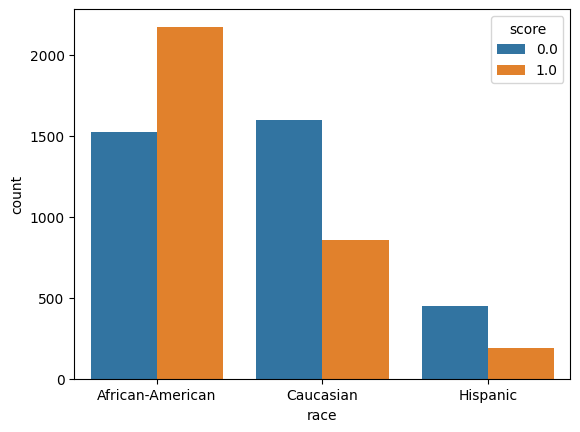
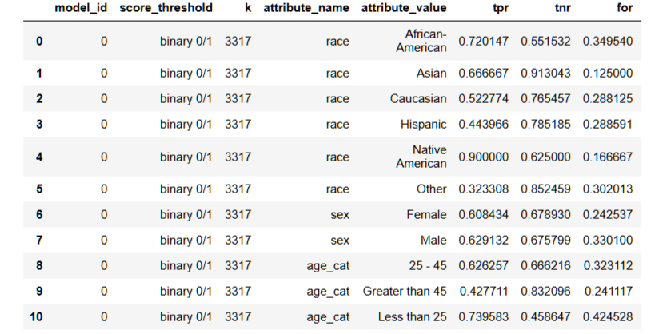

# Evaluating Aequitas Values for Bias and Parity ≠

This repository contains a fairness audit of the COMPAS recidivism risk scores using [Aequitas](https://github.com/dssg/aequitas), an open-source bias and fairness toolkit from the University of Chicago's Center for Data Science and Public Policy. The focus is on interpretation: which groups bear the cost of the model's errors, and why a model can look fair by one measure while failing another.

---

## Project Overview 📊

COMPAS is a commercial risk assessment tool that U.S. courts have used to estimate how likely a defendant is to reoffend. In 2016, a ProPublica investigation of its scores in Broward County, Florida, sparked a national debate about algorithmic bias. This project audits a cleaned version of that data prepared for Aequitas.

- ⚖ **Records:** 7,214 defendants
- ≡ **Score:** The COMPAS prediction (1 = high risk, 0 = low risk)
- ✓ **Label:** Whether the defendant was rearrested within two years (1 = yes, 0 = no)
- ⊕ **Protected attributes:** Race, sex, and age category

**Reference groups:** Each group's error rates are compared with a reference group: **Caucasian** (race), **Male** (sex), and **25–45** (age). A disparity of 1.0 means equal treatment. Aequitas flags a group as unfair when its disparity falls outside **0.8 to 1.25** (the "80% rule").

The countplot shows COMPAS *predictions* (not actual outcomes) for the three largest racial groups. Most African-American defendants were labeled high risk. Most Caucasian and Hispanic defendants were labeled low risk.

---

## Key Findings 🔎

- **African-American defendants who did not reoffend were wrongly labeled high risk at 1.91× the Caucasian rate** (FPR 0.448 vs. 0.235).
- **Caucasian defendants who did reoffend were more often labeled low risk** (FNR 0.477 vs. 0.280 for African-American defendants).
- **Defendants under 25 face the highest false positive rate of any group** (0.541, which is 1.62× the 25–45 rate). Defendants over 45 have the reverse pattern: a low FPR (0.168) and a high FNR (0.572).
- **Precision is nearly equal across race.** When the model labels someone high risk, it is right about 63% of the time for African-American defendants and 59% for Caucasian defendants. The model passes Precision Parity but fails FPR Parity for the same groups.
- **Sex shows a different kind of disparity.** Female and male defendants have nearly identical FPR and FNR. But women labeled high risk were wrong **48.7%** of the time, compared with 36.5% for men (FDR disparity 1.34, which fails FDR Parity).

---

## Models and Performance 🔬

**Error rates and disparities by group** (reference group = 1.00):

| Attribute | Group | Size | FPR | FPR Disparity | FNR | FNR Disparity | Precision |
|---|---|---|---|---|---|---|---|
| Race | African-American | 3,696 | 0.448 | **1.91** | 0.280 | **0.59** | 0.630 |
| Race | Caucasian (ref) | 2,454 | 0.235 | 1.00 | 0.477 | 1.00 | 0.591 |
| Race | Hispanic | 637 | 0.215 | 0.92 | 0.556 | 1.17 | 0.542 |
| Race | Other | 377 | 0.148 | 0.63 | 0.677 | 1.42 | 0.544 |
| Race | Asian | 32 | 0.087 | 0.37 | 0.333 | 0.70 | 0.750 |
| Race | Native American | 18 | 0.375 | 1.60 | 0.100 | 0.21 | 0.750 |
| Sex | Female | 1,395 | 0.321 | 0.99 | 0.392 | 1.06 | 0.513 |
| Sex | Male (ref) | 5,819 | 0.324 | 1.00 | 0.371 | 1.00 | 0.635 |
| Age | Less than 25 | 1,529 | 0.541 | **1.62** | 0.260 | 0.70 | 0.640 |
| Age | 25–45 (ref) | 4,109 | 0.334 | 1.00 | 0.374 | 1.00 | 0.615 |
| Age | Greater than 45 | 1,576 | 0.168 | 0.50 | 0.572 | **1.53** | 0.541 |

**Fairness tests** (✓ = within 0.8–1.25, ✗ = outside):

| Group | FPR Parity | FNR Parity | FDR Parity | Precision Parity |
|---|---|---|---|---|
| African-American | ✗ | ✗ | ✓ | ✓ |
| Hispanic | ✓ | ✓ | ✓ | ✓ |
| Female | ✓ | ✓ | ✗ | ✓ |
| Less than 25 | ✗ | ✗ | ✓ | ✓ |
| Greater than 45 | ✗ | ✗ | ✓ | ✓ |

*Groups with fewer than 50 records (Asian, n = 32; Native American, n = 18) are not shown in this table, because samples this small cannot support reliable statistical conclusions.*

**Metric definitions:** 📊

- **FPR (False Positive Rate):** Share of people who did *not* reoffend but were labeled high risk
- **FNR (False Negative Rate):** Share of people who *did* reoffend but were labeled low risk
- **FDR (False Discovery Rate):** Share of people labeled high risk who did *not* reoffend
- **Precision:** Share of people labeled high risk who *did* reoffend (1 − FDR)

---

## Key Takeaways 💡

**1. The model's errors fall in opposite directions for different groups.**
COMPAS applies the same cutoff to everyone, but it behaves as if the threshold were looser for African-American and younger defendants. They receive more false positives and fewer false negatives. Caucasian, Hispanic, and older defendants see the reverse.

**2. Not all errors cost the same.**
In criminal justice, a false positive can mean higher bail, denied parole, or a longer sentence for someone who would not have reoffended. A false negative means a risk was missed. Because false positives cause direct harm to the person labeled, the FPR disparity for African-American defendants is the most serious finding in this audit.

**3. A model can be fair and unfair at the same time.**
COMPAS passes Precision Parity across race: a "high risk" label means about the same thing regardless of race. It fails FPR Parity: people who did not reoffend are treated very differently. This is not a contradiction. When groups have different base rates (51.4% of African-American defendants were rearrested vs. 39.4% of Caucasian defendants), it is mathematically impossible to satisfy both measures at once. Choosing a fairness metric is a values decision, not just a technical one.

**4. Equal error rates do not guarantee equal treatment.**
Women and men have nearly identical FPR and FNR, yet a "high risk" label is wrong for nearly half of women. A single metric can hide a disparity, so fairness audits should check several.

**5. The label itself may carry bias.**
The outcome is *rearrest*, not *reoffending*. If some communities are policed more heavily, rearrest rates may overstate their true reoffending rates. A model trained on this label can inherit that bias even before any prediction is made.

---

## Repository Contents 📁

| File | Description |
|---|---|
| `YOUR-NOTEBOOK-NAME.ipynb` | Jupyter notebook with data loading, crosstab calculations, disparity analysis, and interpretation |
| `compas-predicted-risk-by-race.png` | COMPAS risk predictions by race (African-American, Caucasian, Hispanic) |
| `aequitas-crosstab-metrics.png` | Aequitas crosstab metrics (TPR, TNR, FOR) by group |
| `README.md` | Project documentation |

---

## Model Evolution 🧬

1. **Exploration:** Visualized COMPAS risk predictions by race
2. **Crosstabs:** Used Aequitas `Group()` to calculate confusion-matrix metrics for every race, sex, and age group
3. **Disparity analysis:** Used Aequitas `Bias()` to compare each group with its reference group
4. **Fairness testing:** Applied the 0.8–1.25 threshold to identify which groups fail each parity test
5. **Interpretation:** Analyzed which groups bear the cost of each type of error and why the metrics conflict

---

## Future Work 🔭

- Check intersectional groups (for example, young African-American men), where disparities may compound
- Test bias mitigation methods such as group-specific thresholds or reweighting, and measure the effect on both FPR and precision
- Add Aequitas visualizations (disparity and fairness plots) to show which groups pass or fail at a glance
- Compare COMPAS with a simple model trained only on age and prior offenses to see whether it adds predictive value
- Apply the same audit to a hiring, lending, or healthcare model, where the cost of each error type differs

---

## Contact Information ✉️

For inquiries about this analysis:

- [LinkedIn Profile](https://www.linkedin.com/in/melissaslawsky/)
- [Client Results](https://melissaslawsky.com/portfolio/)
- [Tableau Portfolio](https://public.tableau.com/app/profile/melissa.slawsky1925/vizzes)
- [Email](mailto:melissa@melissaslawsky.com)

---

## Disclaimer 📝

This project was completed as part of the [Udacity Data Science Nanodegree](https://www.udacity.com/course/data-scientist-nanodegree--nd025) program. The COMPAS dataset was originally compiled by ProPublica and is distributed with the Aequitas toolkit, and the exercise structure was provided by Udacity. All analysis, interpretation, and documentation are my own.

---

© Melissa Slawsky 2026. All Rights Reserved.
